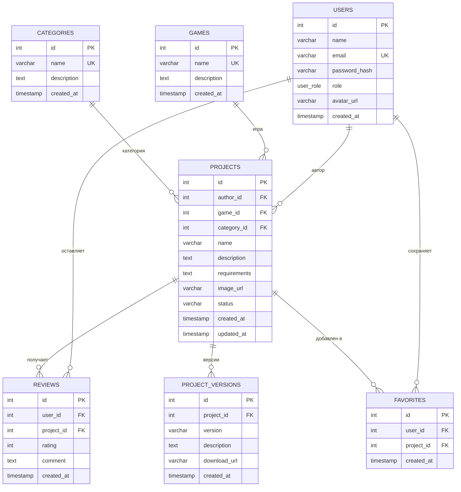

# Пояснительная записка к проекту ModForge

## 1. Введение

### 1.1 Актуальность проекта

Игровые модификации позволяют расширять содержание игр, изменять игровой
процесс и адаптировать интерфейс под предпочтения игроков. Поиск модификаций,
их версий и отзывов в разрозненных источниках затрудняет оценку качества и
совместимости материалов. ModForge объединяет каталог проектов, сведения об
играх и категориях, версии модификаций, пользовательские оценки и список
избранного в одном веб-приложении.

### 1.2 Цель проекта

Цель проекта — разработать клиент-серверную платформу для публикации,
обнаружения и оценки игровых модификаций с разграничением доступа по ролям.

### 1.3 Задачи проекта

Для достижения цели решаются следующие задачи:

1. Спроектировать реляционную базу данных для пользователей, игр, категорий,
   проектов, версий, отзывов и избранного.
2. Реализовать REST API для аутентификации, каталога проектов и связанных
   пользовательских данных.
3. Реализовать регистрацию и вход с хешированием паролей и выдачей JWT.
4. Ограничить операции создания проектов и управления версиями ролями
   пользователя и автора, а изменение проектов — также проверкой владения.
5. Обеспечить поиск и фильтрацию опубликованных проектов.
6. Реализовать отзывы с оценкой и запретом повторной оценки одного проекта
   одним пользователем, а также пользовательское избранное.
7. Создать SPA-клиент с каталогом, страницами проектов, входом, регистрацией
   и избранным.
8. Подготовить контейнеризацию PostgreSQL, backend и frontend и проверить
   основные сценарии API.

### 1.4 Объект и предмет разработки

Объект разработки — процесс публикации и поиска пользовательских модификаций
компьютерных игр. Предмет разработки — веб-система ModForge, включающая
клиентское приложение, REST API, механизмы авторизации и реляционную базу
данных.

## 2. Архитектура приложения

### 2.1 Общая схема

Система построена по клиент-серверной архитектуре и включает три основных
компонента:

- **Frontend:** React SPA, собираемая Vite и раздаваемая Nginx. React Router
  отвечает за маршруты, Axios — за HTTP-запросы. JWT хранится в
  `localStorage` и передаётся в заголовке `Authorization: Bearer`.
- **Backend:** NestJS REST API. Функциональность разделена на модули
  `Auth`, `Users`, `Projects`, `Versions`, `Reviews`, `Favorites`,
  `Categories` и `Games`. DTO и `class-validator` обеспечивают проверку
  входных данных; Swagger публикует документацию OpenAPI по адресу
  `/api/docs`.
- **Database:** PostgreSQL с TypeORM-сущностями. Backend взаимодействует с
  базой через TypeORM и получает параметры подключения из `DATABASE_URL`.

В локальной контейнерной конфигурации браузер обращается к frontend через
Nginx. Запросы с префиксом `/api` Nginx проксирует в NestJS. Backend подключён
к PostgreSQL по внутренней сети Docker Compose. Запуск backend ожидает
успешного healthcheck базы данных (`pg_isready`).

### 2.2 Обработка запроса и безопасность

Публичные запросы к каталогу проходят через контроллеры NestJS к сервисам,
которые выбирают только опубликованные проекты. Для защищённых операций
клиент передаёт JWT. `JwtAuthGuard` проверяет токен, `RolesGuard` ограничивает
доступ по роли, а `ResourceOwnershipGuard` проверяет владение проектом при
операциях управления им и его версиями. Проверка роли и владения выполняется
на backend; проверки маршрутов во frontend предназначены для навигации и не
заменяют серверную авторизацию.

Пароли пользователей хранятся в виде bcrypt-хешей. Уникальные составные
ограничения в таблицах отзывов и избранного закрепляют правило «одна запись
пользователя на проект» также на уровне базы данных.

### 2.3 Схема связей сущностей



Связь пользователей с проектами, версиями, отзывами и избранным реализована
через внешние ключи. `FAVORITES` является ассоциативной сущностью для связи
многие-ко-многим между пользователями и проектами. Для `REVIEWS` и `FAVORITES`
установлены уникальные пары `(user_id, project_id)`.

### 2.4 Используемый стек

| Уровень | Технологии |
|---|---|
| Клиент | React, Vite, React Router, Axios |
| Backend | Node.js, NestJS, TypeScript, REST, Swagger/OpenAPI |
| Проверка входных данных | `class-validator`, `class-transformer` |
| Аутентификация | JWT, bcrypt |
| Доступ к данным | TypeORM |
| База данных | PostgreSQL |
| Контейнеризация | Docker, Docker Compose, Nginx |

## 3. REST API

Все перечисленные маршруты имеют префикс `/api`. «Публичный» означает, что
эндпоинт не требует JWT. Для остальных эндпоинтов JWT передаётся в заголовке
`Authorization: Bearer <token>`. Уровни доступа в таблице отражают текущую
реализацию.

| Метод | Эндпоинт | Назначение | Доступ |
|---|---|---|---|
| `POST` | `/auth/register` | Регистрация пользователя и выдача JWT | Публичный; роль новой учётной записи — `user` |
| `POST` | `/auth/login` | Вход и выдача JWT | Публичный |
| `GET` | `/projects` | Список опубликованных проектов, поиск, фильтры, сортировка и пагинация | Публичный |
| `GET` | `/projects/:id` | Детали опубликованного проекта | Публичный |
| `POST` | `/projects` | Создание проекта | `author`, `admin` |
| `PATCH` | `/projects/:id` | Изменение проекта | Автор-владелец или `admin`; менять статус может только `admin` |
| `DELETE` | `/projects/:id` | Удаление проекта и связанных данных | Автор-владелец или `admin` |
| `GET` | `/projects/:projectId/versions` | Список версий опубликованного проекта | Публичный |
| `POST` | `/projects/:projectId/versions` | Добавление версии проекта | Владелец-автор или `admin` |
| `PATCH` | `/projects/:projectId/versions/:versionId` | Изменение версии | Владелец-автор или `admin` |
| `DELETE` | `/projects/:projectId/versions/:versionId` | Удаление версии | Владелец-автор или `admin` |
| `GET` | `/reviews/projects/:projectId` | Получение отзывов опубликованного проекта | Публичный |
| `POST` | `/reviews/projects/:projectId` | Создание отзыва с оценкой 1–5 | Любой авторизованный пользователь; один отзыв на проект |
| `PATCH` | `/reviews/:reviewId` | Изменение собственного отзыва | Автор отзыва или `admin` |
| `DELETE` | `/reviews/:reviewId` | Удаление отзыва | Автор отзыва или `admin` |
| `GET` | `/favorites` | Список избранных проектов текущего пользователя | Любой авторизованный пользователь; только собственные записи |
| `POST` | `/favorites/:projectId` | Добавление проекта в избранное | Любой авторизованный пользователь |
| `DELETE` | `/favorites/:projectId` | Удаление проекта из избранного | Любой авторизованный пользователь; только собственная запись |
| `GET` | `/games` | Список игр | Публичный |
| `GET` | `/games/:id` | Информация об игре | Публичный |
| `GET` | `/categories` | Список категорий | Публичный |
| `GET` | `/categories/:id` | Информация о категории | Публичный |

Для запросов создания используются `POST`, для получения — `GET`, для частичного
изменения — `PATCH`, для удаления — `DELETE`. Маршруты `PUT` в текущей версии
не реализованы. Контроллер `UsersController` пока не содержит публичных
маршрутов; отдельный API администраторской аналитики в текущей реализации
также отсутствует.

Основные сценарии API дополнительно описаны в Postman-коллекции
[ModForge-Use-Cases.postman_collection.json](./postman/ModForge-Use-Cases.postman_collection.json).

## 4. Локальный запуск

### 4.1 Требования

- Docker Desktop или Docker Engine с Docker Compose.
- Свободные порты `8080`, `3000` и `5432` либо настройка соответствующих
  переменных окружения.

### 4.2 Запуск контейнеров

Из корневого каталога проекта выполнить:

```sh
docker compose up --build
```

Compose собирает образы NestJS и React/Vite, запускает PostgreSQL, backend и
frontend. Backend ожидает, пока healthcheck PostgreSQL подтвердит готовность
принимать подключения. Nginx frontend проксирует `/api` запросы к backend.

Адреса после запуска:

- клиентское приложение: `http://localhost:8080`;
- REST API: `http://localhost:3000/api`;
- Swagger UI: `http://localhost:3000/api/docs`;
- PostgreSQL: `localhost:5432`.

Для запуска контейнеров в фоне используется `docker compose up --build -d`.
Проверить состояние можно командой `docker compose ps`, просмотреть журналы —
`docker compose logs -f backend`.

### 4.3 Подготовка демонстрационных данных

Для локальной демонстрации после успешного запуска стека выполнить:

```sh
docker compose exec backend npm run seed
```

Сидер создаёт демонстрационные учётные записи, категории, игры, проекты,
версии, отзывы и избранное. Пароль тестовых учётных записей —
`password123`; использовать их в продуктивной среде нельзя.

### 4.4 Остановка

Для остановки контейнеров без удаления данных PostgreSQL выполнить:

```sh
docker compose down
```

Данные сохраняются в именованном Docker volume `postgres_data`. Команда
`docker compose down -v` удаляет этот volume вместе с данными и для обычной
остановки не требуется.

### 4.5 Переменные окружения и замечания

Compose поддерживает `POSTGRES_USER`, `POSTGRES_PASSWORD`, `POSTGRES_DB`,
`JWT_SECRET`, `DB_SYNCHRONIZE`, а также переменные портов `FRONTEND_PORT`,
`BACKEND_PORT` и `POSTGRES_PORT`. Значения по умолчанию предназначены только
для локальной разработки. Перед развертыванием необходимо задать собственный
секрет JWT и пароль базы данных. В production следует выключить
`DB_SYNCHRONIZE` и применять версионируемые миграции TypeORM.
